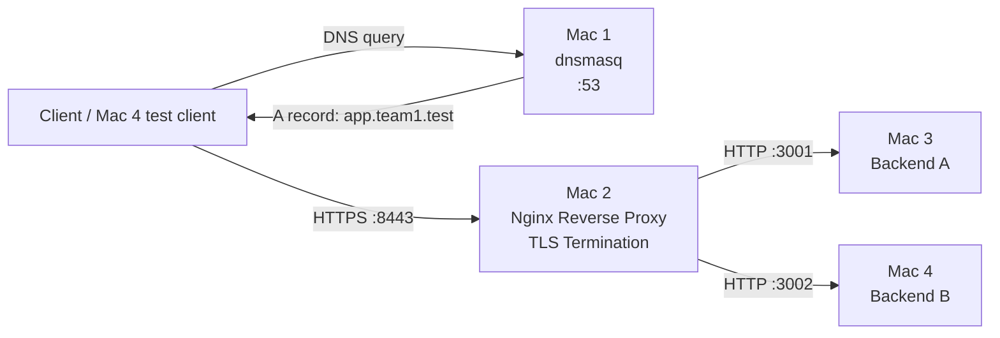

# Network Topology

## Responsibilities

- **Mac 1**: local DNS and upstream DNS forwarding.
- **Mac 2**: HTTP/HTTPS entry point, TLS termination, reverse proxying and load balancing.
- **Mac 3**: Backend A application server.
- **Mac 4**: Backend B application server and client for several validation tests.
